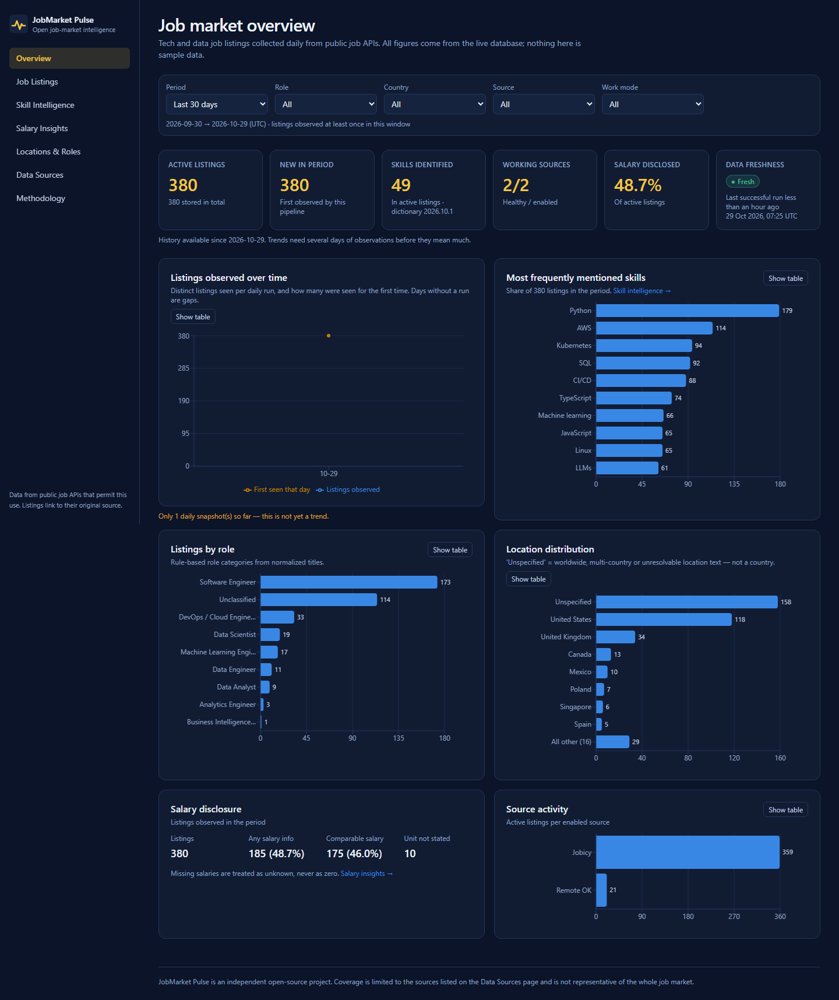
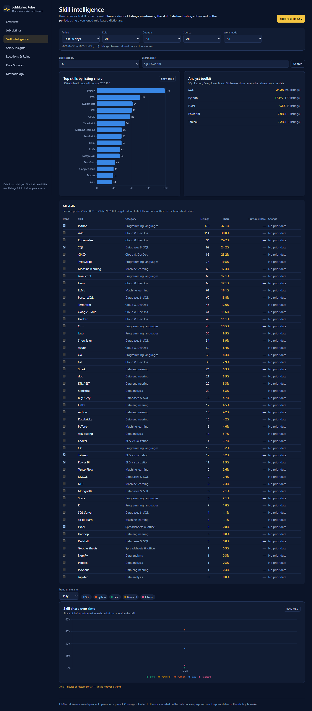
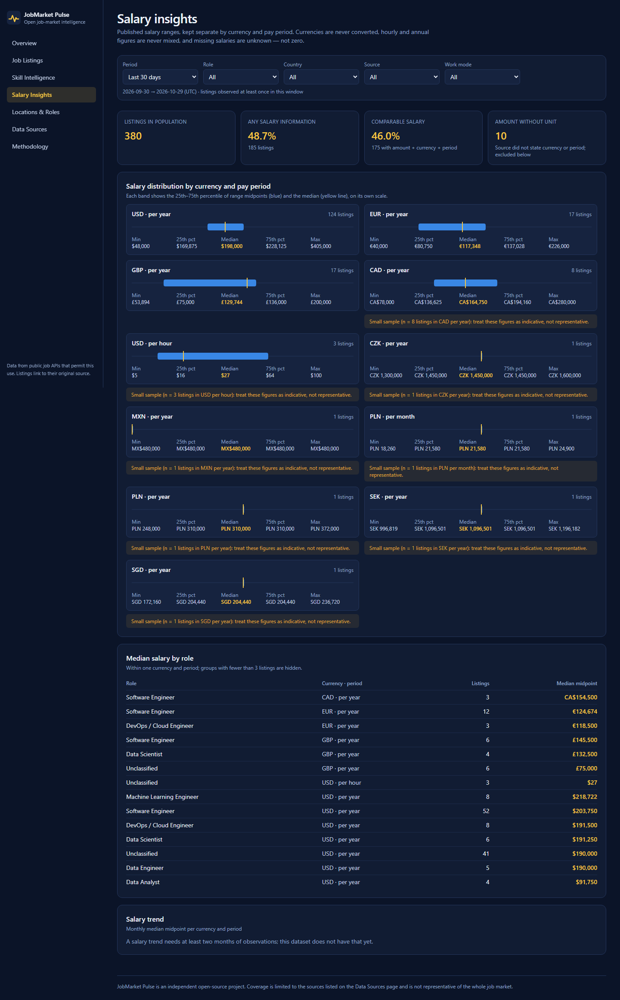
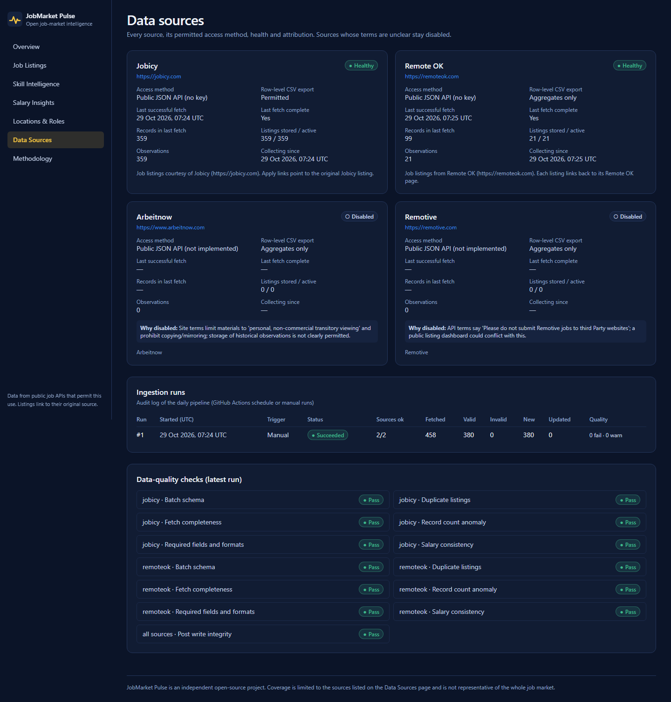
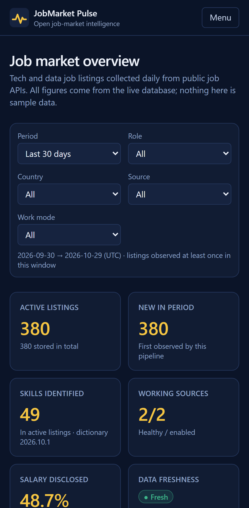
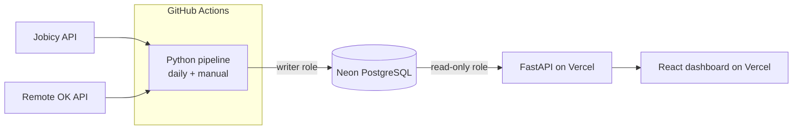

# JobMarket Pulse — Open-Source Job Market Intelligence

An automated data-engineering pipeline that collects **permitted** public tech and data job
listings every day, stores them as a **historical dataset** in PostgreSQL, and serves skill-demand,
role, location, salary and listing-lifecycle analytics through a read-only FastAPI service and a
React dashboard.

> Every number on the dashboard comes from the live database. Nothing is sample data, and unknown
> values are shown as unknown — never as zero.

<!-- LIVE-LINKS:START -->
**Live dashboard:** https://jobmarket-pulse-web.vercel.app ·
**API:** https://jobmarket-pulse-api.vercel.app/api/v1/health ·
**API docs:** https://jobmarket-pulse-api.vercel.app/api/docs
(verified 2026-10-29 — see [Verification status](#verification-status))


<!-- LIVE-LINKS:END -->

## Screenshots (production, 2026-10-29)
| Skill intelligence | Salary insights | Data sources | Phone |
|---|---|---|---|
|  |  |  |  |

The first day of data means the trend charts have a single point; the dashboard says so instead of
drawing a trend.

## Why this project
Job boards show today's postings; they don't keep history, and they don't measure how often a
skill is asked for. JobMarket Pulse builds its own dataset — one daily snapshot per listing — so
questions like *"What share of data-analyst listings mention SQL, Python, Excel, Power BI or
Tableau, and is it changing?"* can be answered with transparent, reproducible SQL.

## Features
- **Daily ingestion** in GitHub Actions from two sources whose terms permit it (Jobicy, Remote OK),
  with retries, `Retry-After` handling, request spacing and a per-source host allow-list.
- **Normalization:** titles, roles (rule-based), locations (only when unambiguous), remote/hybrid/
  on-site with its evidence basis, employment type, seniority, salaries (min/max/currency/period
  kept separate; no conversion, no annualising).
- **Versioned skill extraction** (50 skills, 8 categories) with bounded matching that avoids classic
  false positives (`R&D`, `GitHub`, "excel at").
- **Historical snapshots** (one row per listing per day), idempotent upserts, deterministic dedup.
- **Honest lifecycle:** *active* / *not seen recently* (inferred only after complete fetches) /
  *reported closed* (explicit source status). Failed fetches never expire listings.
- **Data quality:** Pydantic record contracts, Pandera batch checks, anomaly detection, audit log
  of every run, database constraints.
- **Read-only API** (FastAPI, OpenAPI docs) on a SELECT-only database role inside read-only
  transactions; CSV exports that respect each source's redistribution terms.
- **Dashboard** (React + TypeScript + Tailwind + Recharts): Overview, Job Listings, Skill
  Intelligence, Salary Insights, Locations & Roles, Data Sources, Methodology — responsive, with
  loading/empty/error states and a table view for every chart.

## Architecture



Pipeline: **fetch → parse → normalize → validate (Pydantic) → deduplicate → batch checks (Pandera)
→ anomaly check → upsert jobs + daily observations + skill links → lifecycle → data-quality audit.**
Details: [docs/ARCHITECTURE.md](docs/ARCHITECTURE.md).

## Tech stack
Python 3.12 · uv · requests · BeautifulSoup · Pydantic · pandas · Pandera · SQLAlchemy 2 ·
psycopg 3 · Alembic · FastAPI · PostgreSQL (Neon) · pytest · ruff · mypy ·
React 19 · TypeScript · Vite · Tailwind CSS 4 · Recharts · Vitest · Playwright ·
GitHub Actions · Vercel.

## Database design
`sources`, `jobs` (latest state), `job_observations` (unique per job per day), `skills`,
`job_skills` (per dictionary version), `job_descriptions` (transient), `ingestion_runs`,
`data_quality_results`, plus six analytics views for BI. Three roles: owner (migrations),
`jmp_ingest` (no deletes of history, no DDL), `jmp_api_ro` (SELECT only, read-only by default).
See [docs/DATABASE_SCHEMA.md](docs/DATABASE_SCHEMA.md).

## Data sources and compliance
| Source | Status | Notes |
|---|---|---|
| [Jobicy](https://jobicy.com) | enabled | Public API; storage and redistribution permitted with attribution. Listings link to Jobicy. |
| [Remote OK](https://remoteok.com) | enabled | Public API; link back + name required. Terms silent on storage → descriptions not stored, row-level export disabled. |
| Arbeitnow, Remotive | disabled | Terms restrict copying/mirroring or third-party display. |

Restrictive boards (LinkedIn, Indeed, Glassdoor, Naukri) are not collected. Full analysis:
[docs/SOURCE_COMPLIANCE.md](docs/SOURCE_COMPLIANCE.md) · [docs/DATA_SOURCES.md](docs/DATA_SOURCES.md).

**Coverage limits:** both sources are remote-focused international boards with a US/Europe skew;
India-based listings appear only incidentally. This is a sample of public postings on two boards,
not a census of any job market.

## Data quality
Required fields, URL host must match the source, timestamps sane, enum values, salary
consistency, duplicate keys, sudden record-count drops, incomplete fetches, snapshot duplication
and post-write integrity — each recorded per run in `data_quality_results` and shown on the
dashboard. Definitions: [docs/DATA_DICTIONARY.md](docs/DATA_DICTIONARY.md).

## Local setup

Prerequisites: Python 3.12, [uv](https://docs.astral.sh/uv/), Node.js 22+ (24 used), PostgreSQL 15+.

```bash
git clone https://github.com/parammeet83/job-market-intelligence.git
cd job-market-intelligence
uv sync                              # Python deps from uv.lock
cp .env.example .env                 # then edit: MIGRATION_DATABASE_URL, EXPECTED_DATABASE_NAME
uv run alembic upgrade head          # create schema
uv run python -m backend.ops.roles provision --write-env .env   # least-privilege roles
uv run python -m backend.ingestion.cli run --dry-run            # fetch + validate, no writes
uv run python -m backend.ingestion.cli run                      # load real data
uv run uvicorn backend.app.main:app --port 8000                 # API → http://localhost:8000/api/docs
cd frontend && npm ci && npm run dev                            # dashboard → http://localhost:5173
```

Other commands:
```bash
uv run python -m backend.ingestion.cli check-sources     # health-check enabled sources
uv run python -m backend.ingestion.cli run --source jobicy
uv run python -m backend.ingestion.cli reprocess-skills  # after a dictionary version bump
uv run python -m backend.ops.roles verify                # prove role privileges (16 checks)
```

## Tests
```bash
uv run ruff check backend migrations && uv run mypy && uv run pytest -q --cov
cd frontend && npm run lint && npm run typecheck && npm test && npm run build
npx playwright test     # e2e; set E2E_BASE_URL / E2E_API_URL for a deployed stack
```
See [docs/TESTING.md](docs/TESTING.md) for what each layer covers and the latest recorded results.

## GitHub Actions
| Workflow | Trigger | Purpose |
|---|---|---|
| `ci.yml` | push / PR | ruff, mypy, Alembic upgrade + `check` on PostgreSQL 17, pytest (unit + integration), frontend lint/types/tests/build, gitleaks |
| `ingest.yml` | daily 03:17 UTC + manual (`dry_run` option) | runs the pipeline with the `INGEST_DATABASE_URL` secret; job summary table |
| `migrate.yml` | manual only, type `migrate` | guarded Alembic upgrade (aborts on unexpected database name) |
| `smoke.yml` | manual + daily 04:47 UTC | Playwright against the deployed site (needs `DASHBOARD_URL`, `API_URL` variables) |

Actions are pinned to commit SHAs; workflows use `contents: read`.

## Deployment
Neon Free (PostgreSQL) · Vercel Hobby (API function + static dashboard, two projects) · GitHub
Actions (ingestion). Step-by-step: [docs/DEPLOYMENT.md](docs/DEPLOYMENT.md). Operations:
[docs/OPERATIONS_RUNBOOK.md](docs/OPERATIONS_RUNBOOK.md).

## CSV, Excel and Power BI
CSV endpoints for listings, skills and daily observations; Power Query and DAX examples; read-only
PostgreSQL views for BI tools: [docs/POWER_BI_GUIDE.md](docs/POWER_BI_GUIDE.md).
Example SQL: [`sql/examples/`](sql/examples).

## Verification status
<!-- VERIFICATION:START -->
| Check | Status |
|---|---|
| Local pipeline against live sources (dev database) | ✅ 2026-10-29: 442 records fetched, 364 valid in scope, 0 invalid; second run 0 inserted / 364 updated (idempotent) |
| Backend tests (local PostgreSQL 17) | ✅ 160 passed |
| Frontend tests | ✅ 22 passed; Playwright e2e on local stack 18 passed |
| GitHub CI | ✅ 2026-10-29, run 40830848766 on `94b2918`: backend 160 passed (89 % coverage), frontend 22 passed, lint/types/build clean, `alembic check` clean, gitleaks no leaks |
| Production database (Neon Free, PostgreSQL 18.6, database `neondb`) | ✅ migrations at `0002`; roles provisioned; `roles verify` 16/16 PASS against production |
| First production ingestion (GitHub Actions run 40835215566, manual) | ✅ succeeded: 458 fetched, 380 valid listings inserted (359 Jobicy, 21 Remote OK), 0 invalid, 78 out of scope, 380 observations, 1,598 skill links; all data-quality checks pass |
| Production API (Vercel Hobby) | ✅ external checks: `/api/v1/health` → database ok; `/api/docs` 200; invalid input 422; POST 405; CORS allows only the dashboard origin |
| Production dashboard (Vercel Hobby) | ✅ Playwright against production: 18/18 from this machine and 18/18 on GitHub runners (smoke run 40836104559), desktop 1440×900 + Pixel 7 |
| Scheduled ingestion | ⏳ daily schedule configured (03:17 UTC) with the secret in place; the first *scheduled* run has not happened yet — only the manual run above is verified |
<!-- VERIFICATION:END -->

## Known limitations
- Two sources only; remote-focused, US/Europe-heavy; incidental India coverage.
- Trends need weeks of daily history; early charts show very few points (flagged on the dashboard).
- Role categories, locations and skills are rule-based; ambiguous values stay unclassified.
- "Not seen recently" is an inference from rolling feeds, not a verified closure.
- Salary statistics exclude amounts without a stated currency and period (all Remote OK salaries).
- GitHub may delay scheduled runs and disables them after 60 days without repository activity.

## Cost
Built to run on free tiers only: Neon Free (suspends instead of charging when limits are reached),
Vercel Hobby (personal, non-commercial), GitHub Actions for a public repository. No paid APIs,
no paid scraping services, no LLM APIs.

## Documentation
[PRD](docs/PRD.md) · [TRD](docs/TRD.md) · [Architecture](docs/ARCHITECTURE.md) ·
[Database schema](docs/DATABASE_SCHEMA.md) · [Data dictionary](docs/DATA_DICTIONARY.md) ·
[Data sources](docs/DATA_SOURCES.md) · [Source compliance](docs/SOURCE_COMPLIANCE.md) ·
[API](docs/API.md) · [Deployment](docs/DEPLOYMENT.md) · [Testing](docs/TESTING.md) ·
[Operations runbook](docs/OPERATIONS_RUNBOOK.md) · [Power BI guide](docs/POWER_BI_GUIDE.md) ·
[Implementation plan](implementation_plan.md) · [Tasks](TASKS.md)

Job listing data belongs to the respective sources and employers; this project shows normalized
fields and links back to the original listings.
