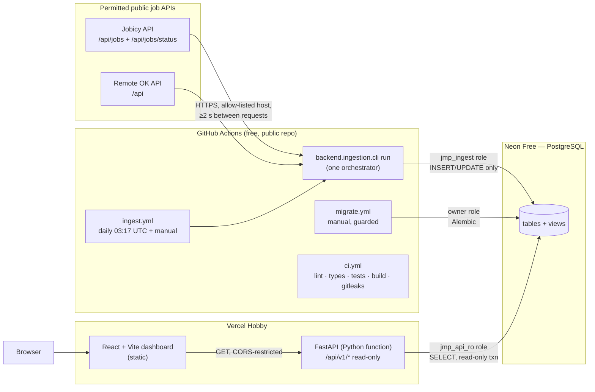
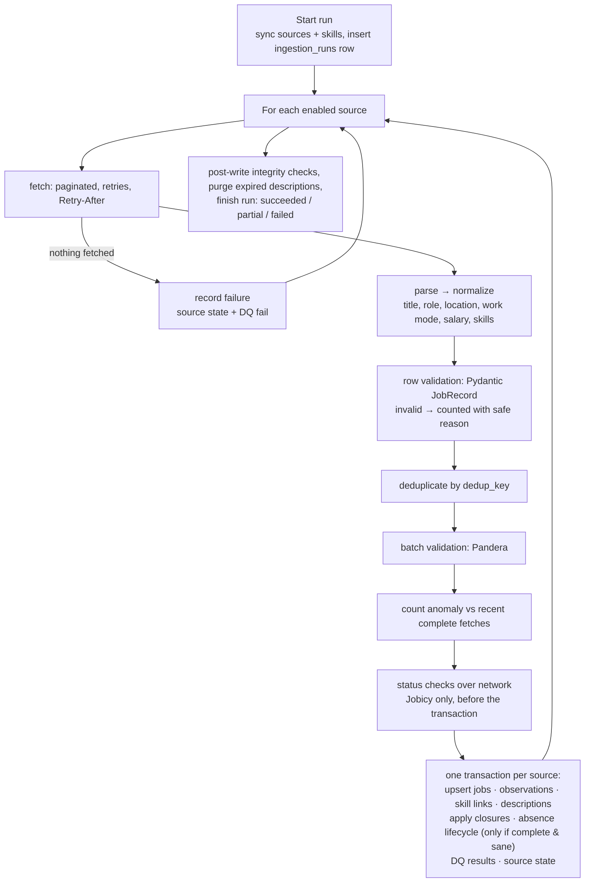

# Architecture

JobMarket Pulse has three runtime parts that share one PostgreSQL database and one Python codebase.



## Pipeline



Key properties:

- **One orchestrator** (`backend/ingestion/orchestrator.py::run_pipeline`) used by the CLI, both
  GitHub Actions triggers, and the integration tests (which inject fixture adapters).
- **Idempotent:** upserts keyed by `dedup_key`; observations unique per job per day; skill links
  replaced per dictionary version.
- **Failure isolation:** each source is processed and committed independently. A failing source
  is recorded and others continue; a failed write rolls back only that source.
- **Conservative history:** absence inference only after complete, non-empty, non-anomalous
  fetches; closures only from explicit source status; no deletes.
- **Dry run:** `--dry-run` fetches and validates, reads existing keys to report would-insert /
  would-update, and writes nothing.

## Code layout

```
backend/
  core/           settings (pydantic-settings), engine factory, JSON logging + redaction
  app/            FastAPI: main.py, api/ (v1, exports, deps), schemas/, services/jobs.py,
                  analytics/sql.py (loads sql/analytics), database.py, models/ (tables)
  ingestion/      cli.py, orchestrator.py, persistence.py, reprocess.py, http.py, config.py,
                  sources/ (base, jobicy, remoteok), transformations/, validation/, skills/
  ops/roles.py    least-privilege role provisioning + verification
  tests/          unit/ (no DB), integration/ (PostgreSQL), fixtures/ (synthetic payloads)
config/           sources.toml, roles.toml, skills.toml
migrations/       Alembic env + versions
sql/              views/ (migration-applied), analytics/ (API queries), examples/ (BI queries)
frontend/         React 19 + TypeScript + Vite + Tailwind 4 + Recharts; Vitest; Playwright e2e
.github/workflows ci.yml, ingest.yml, migrate.yml, smoke.yml
```

## API

FastAPI app `backend.app.main:app`, deployed to Vercel via `[tool.vercel] entrypoint`. Every
request uses a connection from a small pool (pre-ping, 300 s recycle, prepared statements off for
Neon's PgBouncer), opens a `READ ONLY` transaction with an 8 s statement timeout, and always rolls
back. SQL for analytics lives in `sql/analytics/*.sql` with bound parameters; the job listing uses
SQLAlchemy Core with whitelisted sorting and escaped `ILIKE` patterns.

## Frontend

Static SPA on Vercel. Calls the API at `VITE_API_BASE_URL` (public, non-secret). Filters are
stored in the URL. Every chart is driven by an API response and has a table view; loading,
empty, error and retry states are explicit. Chart colours were validated for colour-vision
deficiency separation and contrast on the navy surface.

## Security boundaries

| Concern | Control |
|---|---|
| Write access from the internet | None: API exposes GET only; DB role is SELECT-only with read-only default; each request is a read-only transaction |
| Credentials | Only in GitHub secrets / Vercel env (server-side) / local git-ignored `.env`; never in `VITE_*`; logs and stored errors are redacted |
| SSRF | Source URLs come from config, never from users; per-source host allow-list; redirects re-checked |
| Injection | Bound parameters everywhere; LIKE wildcards escaped; sort keys whitelisted; CSV formula prefixing |
| CORS | `CORS_ORIGINS` = deployed dashboard origin; GET/HEAD/OPTIONS only; no credentials |
| Abuse | page size ≤ 100, date range ≤ 730 days, export row caps, statement timeouts |
