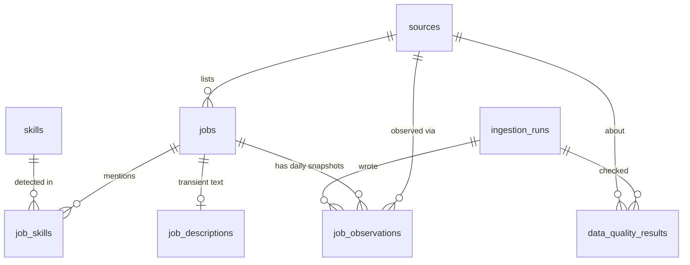

# Database schema

PostgreSQL (Neon in production, PostgreSQL 17 locally/CI). The schema is created **only** by Alembic
migrations (`migrations/versions/`); the application never creates or resets tables.
Table definitions in code: [`backend/app/models/__init__.py`](../backend/app/models/__init__.py).
`alembic check` in CI proves the models and migrations agree.

| Migration | Contents |
|---|---|
| `0001_initial_schema` | 8 tables with constraints and indexes |
| `0002_analytics_views` | 6 views from `sql/views/v1_analytics_views.sql` |

Both `downgrade()` functions refuse to run unless `ALLOW_DESTRUCTIVE_DOWNGRADE=1` is set.

## Entity relationships

## Tables

### `sources`
Registry synchronised from `config/sources.toml` at the start of each run, plus health state.
PK `id` (e.g. `jobicy`). Key columns: `enabled`, `allow_row_export`, `attribution`, `disabled_reason`,
`last_attempt_at`, `last_success_at`, `last_fetch_complete`, `last_record_count`, `last_error_at`,
`last_error_summary` (redacted, ≤ 300 chars).

### `jobs` — latest normalized state of each listing
| Column | Notes |
|---|---|
| `id` | bigint PK |
| `source_id` | FK → sources |
| `source_job_id` | native id; **unique per source** (partial unique index where not null) |
| `canonical_url` | https, tracking params removed |
| `dedup_key` | **unique**; `<source>:id:<id>` → `<source>:url:<url>` → `<source>:fp:<sha256>` |
| `cross_source_key` | title+company fingerprint for cross-board analysis (not used to merge) |
| `title_original`, `title_normalized`, `role_category` | role is NULL when no rule matches |
| `company`, `location_original`, `city`, `region`, `country` | structured fields only when unambiguous |
| `work_mode` (`remote`/`hybrid`/`onsite`), `work_mode_basis` (`text`/`source_default`) | |
| `employment_type`, `seniority` | NULL when unknown |
| `salary_text`, `salary_min`, `salary_max`, `salary_currency`, `salary_period` | never 0 for unknown |
| `source_tags` | text[] |
| `published_at` | from the source, may be NULL |
| `first_seen_at`, `last_seen_at` | pipeline observation times |
| `last_verified_active_at` | last time the source's status API said "active" |
| `status` (`active`/`unconfirmed`/`expired`), `status_changed_at`, `source_reported_closed_at`, `consecutive_misses` | lifecycle |
| `skills_dictionary_version` | version of the job's latest skill extraction |

Check constraints: enum values, `salary_currency ~ '^[A-Z]{3}$'`, `salary_min <= salary_max`,
salaries > 0, `first_seen_at <= last_seen_at`.
Indexes: `status`, `first_seen_at`, `last_seen_at`, `role_category`, `country`, `company`, `(source_id, status)`.

### `job_observations` — historical snapshots
One row per job per UTC date: **unique `(job_id, observation_date)`**. Columns: `run_id` (FK),
`source_id`, `observed_at`, `observation_method` (`feed` or `status_check`), `observed_status`, and
the time-varying fields (`title_normalized`, `role_category`, `work_mode`, salary fields).
Re-running on the same day updates that day's row instead of duplicating it. The writer role cannot
delete observations. Indexes: `observation_date`, `run_id`.

### `skills` — dictionary
`slug` (unique), `name`, `category`, `aliases` (text[]), `dictionary_version` (version that last
defined it), `active` (false once removed from the dictionary).

### `job_skills`
PK `(job_id, skill_id, dictionary_version)` — no duplicate association per version. `matched_in`
lists the fields (`title`, `tags`, `description`) where the skill was found. Analytics use the
version equal to `jobs.skills_dictionary_version`, so a job is never counted under two rule sets.

### `job_descriptions` — transient
`job_id` PK, `text_plain`, `captured_at`, `purge_after`. Only for sources with
`retain_description_days > 0` (Jobicy, 30 days); purged at the end of every run; not readable by
the API role.

### `ingestion_runs` — audit
Start/finish, `trigger` (`cli`, `schedule`, `manual`, `test`), `status`
(`running`, `succeeded`, `partial`, `failed`), dictionary version, counts (fetched, valid, invalid,
out of scope, duplicates, inserted, updated, observations, skill links, status checks, expired,
unconfirmed, errors), `error_summary` (redacted) and `details` (JSONB per source).

### `data_quality_results`
One row per check per source per run: `check_name`, `outcome` (`pass`/`warn`/`fail`),
`failed_count`, `details` (JSONB). See [DATA_DICTIONARY.md](DATA_DICTIONARY.md#data-quality-checks).

## Views (BI interface)

| View | Purpose |
|---|---|
| `v_jobs_public` | job fields + source name, attribution and `allow_row_export`; no internal columns |
| `v_job_skills_current` | each job's skills for its current dictionary version |
| `v_daily_listing_activity` | per date and source: listings observed / first seen |
| `v_skill_share_active` | skill share among **active** listings (denominator = active listings) |
| `v_salary_disclosure` | per source and role: listings, with salary info, with comparable salary |
| `v_source_health` | source health, freshness and record counts |

## Roles and privileges

Created by `python -m backend.ops.roles provision` (owner/migration role required).

| Role | Used by | Privileges |
|---|---|---|
| owner (Neon default, e.g. `neondb_owner`) | migrations, role provisioning | DDL |
| `jmp_ingest` | pipeline (GitHub Actions) | SELECT/INSERT/UPDATE on sources, jobs, job_observations, skills, ingestion_runs, data_quality_results; DELETE only on job_skills and job_descriptions; sequence usage; `statement_timeout=120s`. **No** DDL, TRUNCATE, or DELETE on jobs/observations. |
| `jmp_api_ro` | public API (Vercel) | SELECT on the 7 analytics tables and 6 views (not job_descriptions); `default_transaction_read_only=on`; `statement_timeout=10s` |

`python -m backend.ops.roles verify` attempts forbidden operations as each role (inside rolled-back
transactions) and reports 16 checks; the same checks run in the integration tests.

## Business rules enforced in the database
- One job per `dedup_key`; one native id per source.
- One observation per job per day.
- No duplicate skill link per dictionary version.
- Inconsistent salary ranges, malformed currencies, unknown enums cannot be stored.
- Foreign keys on every relationship (`ON DELETE CASCADE` only from jobs to its dependent rows,
  which the writer role cannot trigger because it cannot delete jobs).
